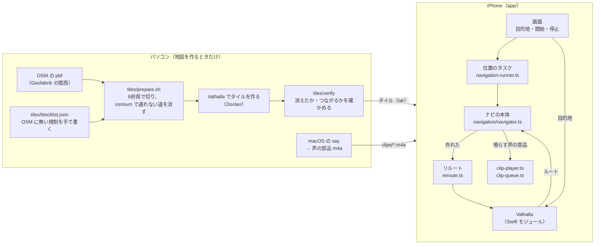
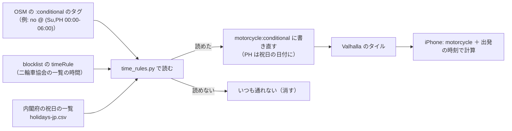
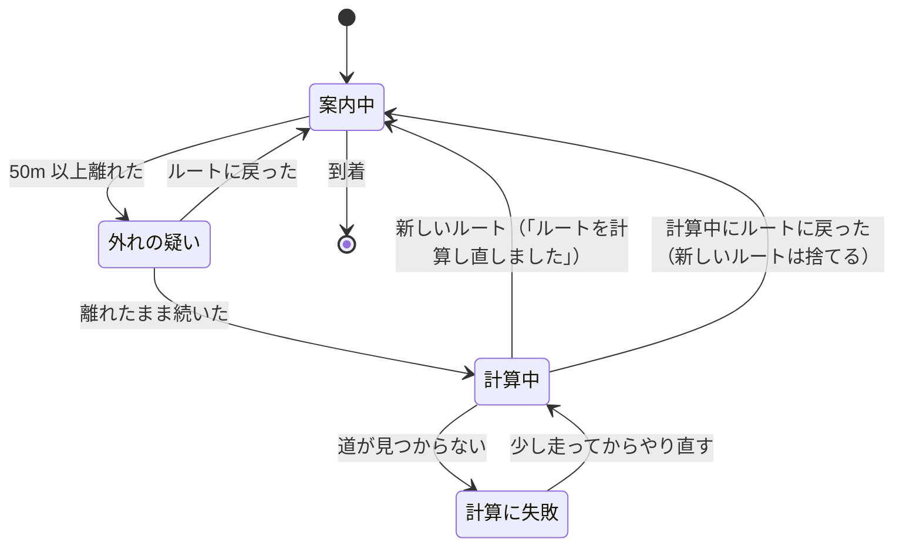
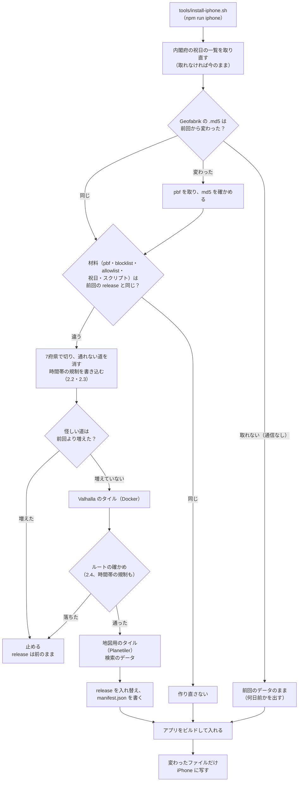

# cub-navigation-2 設計書（下書き）

原付二種（125cc）で、高速道路と自動車専用道路（以下「自専道」）を通らずに走るための iPhone の音声ナビ。
前の版（[cub-navigation](https://github.com/tamai-hideyuki/cub-navigation)）では、ルートをパソコンで前もって作ってアプリに入れていた。今回は**目的地を決めると、iPhone の中で現在地からルートを計算し、外れたら計算し直す（リルート）**。

この文書は下書き。「仮」と書いた所は、まだ本人と決めていない。

## 0. 前提

| 項目 | 内容 |
|---|---|
| 車両 | 原付二種（125cc）。高速道路・自専道は走れない |
| 範囲 | **関西の7府県**: 大阪府・京都府・兵庫県・奈良県・滋賀県・和歌山県・三重県（2026-11-26 に決定。三重県は伊勢へ行くために同じ日に足した）。府県の一覧は `tiles/make_area.py` の `PREFECTURES` の1か所 |
| 端末 | iPhone 1台。ハンドルに固定し、USB で給電する |
| 音の出口 | Bluetooth のインカム |
| ルートの計算 | **iPhone の中**（2026-11-26 に決定）。走っている間は通信しない |
| 目的地の決め方 | 走り出す前に画面で決める。名前の検索のときだけ通信してよい |
| 画面 | 地図を載せ、ルートのどこにいるかが分かるようにする。地図も通信なしで描く（どちらも 2026-11-26 に決定） |
| 地図の新しさ | iPhone に入れるたびに（`tools/install-iphone.sh`）、最新の OSM からルート用と地図用のタイル・検索のデータを作り直して入れる（2026-11-26 に決定・作成。9 章） |
| 外れたとき | 現在地から計算し直し、新しいルートで案内を続ける |
| 最短の意味 | 仮: 時間が最短。距離の最短に切り替えられる作りにはしておく |
| アプリの土台 | 仮: 前の版の Expo を引き継ぎ、計算エンジンだけ Swift のモジュールで包む |
| 案内の声 | 道路名は読まず、距離と向きの組み合わせ（22 通り）を前もって全部作り、1つの案内を1つの声で鳴らす（2026-11-26、PoC 6 で決定。4 章） |

## 1. 全体の流れ



前の版との違いは2つ。ルートを作る仕事が「パソコンで1本」から「iPhone でその場で何本でも」に移ったこと。そのため、**通れない道を避けることを、ルートを1本ずつ確かめるのではなく、地図のデータから消すことで保証する**こと。

## 2. 計算エンジン

### 2.1 Valhalla を使う

iPhone の中で動くルートの計算エンジンとして [Valhalla](https://github.com/valhalla/valhalla) を使う。iOS 向けのビルドが Swift Package（[Rallista/valhalla-mobile](https://github.com/Rallista/valhalla-mobile)）としてあり、端末に置いたタイルだけでルートを計算できる。

| 判断 | 理由 | 採らなかった案 |
|---|---|---|
| Valhalla（valhalla-mobile） | iOS で動くビルドがある。案内（曲がる所・向き）も返す | GraphHopper（iOS で動かす手段がない）、OSRM（iOS 向けが無い）、自前の経路探索（関西の道の数を JS で解くのは重い） |
| 通れない道はデータから消す | Valhalla の `use_highways: 0` は「なるべく避ける」で、通らない保証ではない | 計算の条件だけで避ける |
| `motor_scooter` の条件は使わない | `moped` の規制（原付一種向け）に従うため、原付二種には合わない | — |

計算の条件は `motorcycle` に、上限の速度（`top_speed: 60`）とフェリーを使わない（`use_ferry: 0`）を足し、**出発の時刻（`date_time`）をいつも付ける**。PoC 4 では `auto` を使っていたが、時間帯つきの規制（2.3）を見てもらうために `motorcycle` に替えた（2026-11-26）。Valhalla は二輪の時間帯つきの規制（`motorcycle:conditional`）を、`motorcycle` の計算で、しかも出発の時刻を渡したときだけ見る。`auto` では見ない。通れない道はすでに消してあるので、どちらを選んでも自専道は通らない。

- 出発の時刻は、日本の時刻（UTC+9）で「2026-11-29T03:00」の形に書く（`app/src/routing/request.ts` の `formatJapanTime`）。iPhone の時刻の設定が日本でなくても同じになる。リルートでも、そのときの時刻を付ける
- 16 組で `auto` と比べると、ほとんど同じで、豊岡 → 彦根が 261.0km から 245.5km、舞鶴 → 新宮が 304.2km から 298.4km（どちらも消した道は通らない）

**`use_highways` は 1 にする（避けない）。** Valhalla の「高速道路」には国道（`trunk`）も入っていて、0 にすると国道を避けて県道や山道に回る。PoC 4 では、豊岡 → 彦根が 276km（`use_highways: 0`）から 261km（`1`）に、三宮 → 奈良が 93km から 72km になった。

### 2.2 範囲の切り方

Geofabrik の関西の pbf を取り、7府県（大阪・京都・兵庫・奈良・滋賀・和歌山・三重）の境界で切る。Geofabrik の「関西」には三重県も入っている。

- 境界は同じ pbf の中の都道府県の境界（`boundary=administrative`・`admin_level=4`）から作り、`osmium extract -p` で切る
- 府県の一覧は `tiles/make_area.py` の `PREFECTURES` だけに書く。範囲の箱は `tiles/data/area.bounds` に書き出し、`build_map.sh` が読む（7府県で 134.232, 33.215, 137.347, 36.168）
- 境界ちょうどで切ると、府県境の近くで一度外に出て戻る道が切れる。境界の外側に少し（仮: 2km）余白を付けて切る
- 範囲の外が目的地のときは、計算する前に「範囲の外です」と画面に出す

### 2.3 消す道

前の版の `poc3/prepare.sh` と同じ考え方で、タイルを作る前の pbf から消す。前の版では motorway と有料道路を GraphHopper の条件で避けていたが、今回はこれらもデータの段で消す。

**「高速道路を避ける」設定では、国道のバイパスのような「一般の国道だが 125cc 以下は通れない」所を弾けない。** そのため、道の種類・通行のタグ・手で書いた一覧の3段で消し、どれにも当たらないが怪しい道は一覧に出して人が見る。迷う道は消す側に倒す（遠回りになるだけで、通れない道を通るよりよい）。

#### 1段目: 道の種類

| 消す道 | タグ |
|---|---|
| 高速道路 | `highway=motorway`, `highway=motorway_link` |
| 自専道 | `motorroad=yes` |
| 有料道路 | `toll=yes`（125cc で通れる有料道路もあるが、まずは全部消す） |
| フェリー | `route=ferry`（計算の条件でも使わない） |

#### 2段目: 通行のタグ

| 消す道 | タグ |
|---|---|
| 二輪・原付の規制 | `motorcycle`・`access:motorcycle`・`moped`・`access:moped` が `no` |
| 車の規制 | `motor_vehicle`・`access` が `no`・`private`・`permit` など（Valhalla の条件に任せず、データから消す） |
| 決まりに無い値 | `motorcycle` などが、通れる値（`yes`・`designated`・`permissive`・`destination`・`customers`・`delivery`）にも通れない値（`no`・`private`・`permit`・`dismount` など）にも当たらないもの（例: `<125 cc`）。消して、一覧にも出す |
| 時間帯つきの規制 | `motorcycle:conditional`・`moped:conditional`・`motor_vehicle:conditional`・`access:conditional` が `no` など。**読める書き方なら消さずに、時間の規制として残す**（下の「時間帯つきの規制の扱い」）。読めない書き方（`winter` など）は消す |

- `moped=no` は本来は原付一種の規制だが、125cc 以下の規制がこのタグで書かれていることがある。消す側に倒し、原付二種で通れると確かめた道だけ `tiles/allowlist.json` で戻す
- 時間帯つきの規制は、走る日時に合わせて避ける（2026-11-26 から。それまでは、通れる時間でも通れないことにしていた）

#### 3段目: 手で書いた一覧

- `tiles/blocklist.json` に、OSM のタグでは分からない 125cc 以下の通行禁止の区間を書く。`tiles/allowlist.json` には、怪しいが通れると確かめた区間を書く
- 1つの項目は、根拠が同じ1つの区間。名前・区間の説明・way の ID・判定・根拠の強さ（`confidence`）・根拠の要約・資料の URL・確かめた日を持つ。資料の URL が無い項目があると、ビルドを止める
- 根拠は国道事務所・府県・府県警・道路公社の資料と、日本二輪車普及安全協会の「二輪車通行規制区間」の一覧（府県警の提供）。前の版の検証B と同じやり方
- 区間は本線だけでなく、本線にしかつながらないランプも入れる。旧道・側道は入れない
- OSM の way の ID は編集で変わるので、タイルを作るたびに「一覧の way が残っているか」を確かめ、無ければビルドを止める
- `allowlist.json` の道でも、根拠が弱いもの（規制の資料が見つからないだけ、など）は、ルートの下見の画面で「現地の標識を確かめる道」として出す

#### 怪しい道の一覧（人が見る）

どの段にも当たらないが、125cc 以下が通れない道かもしれないものを、タイルを作るたびに一覧に出す。

- 名前に「バイパス」「道路」を含む `trunk`・`primary` で、出入口（`*_link`）があるもの
- 消した道とつながっている・並んでいる `trunk`
- 前回のタイルから、タグが変わった道

#### 2026-11-26 に Overpass で6府県を見た結果

| 道 | タグ | 今の決まりで消えるか |
|---|---|---|
| 姫路バイパス・加古川バイパス・名阪国道・京滋バイパス | `highway=motorway` | 消える（1段目） |
| 太子竜野バイパス（27本） | `highway=trunk`・`motorcycle=<125 cc` | 「決まりに無い値」で消える（2段目）。`motorcycle=no` だけを見ていたら残っていた |
| 太子竜野バイパス（1本） | `highway=trunk`・二輪のタグ無し | 残る。本当に通れるかを資料で確かめる |
| 姫路北バイパスなど（263本） | `moped=no` | 消える（2段目）。通れると確かめたら戻す |

この結果から、**タグの値の書き方はそろっていない**と分かった。決まりに無い値を見落とさないことが要る。

#### 2026-11-26 に怪しい道 22 種類を資料で調べた結果

PoC 4 の怪しい道の一覧（22 種類・273 本）を、資料で1つずつ確かめた。

| 判定 | 道 | 一覧 |
|---|---|---|
| 通れない | 志賀バイパス（志賀IC〜北小松南）と、その北の小松拡幅（〜県道558号の合流点）。本線 42 本とランプ 37 本 | blocklist（県警の資料） |
| 通れない | 桂バイパスの千代原口地下トンネル（約1km）。二輪は排気量に関係なく通行止め | blocklist |
| 通れない | 堺泉北道路の高架本線（助松JCT付近） | blocklist |
| 通れない（安全側） | 太子竜野バイパスの残り 0.1km（規制の起点が資料で特定できない） | blocklist |
| 通れる（料金を払う） | 琵琶湖大橋有料道路（125cc 以下は 10円）、六甲有料道路（第二種原付も 10円） | allowlist |
| 通れる（道路規格・資料） | 栗東水口道路（**高架部を除く。下の突き合わせで訂正**）・洛南道路・清滝生駒道路・西脇北バイパス・橿原バイパス・大和高田バイパス・高取バイパス・一分バイパス・橋本バイパス・石仏バイパス・有田海南道路・日野水口グリーンバイパス・桂バイパス（トンネル以外） | allowlist |
| 通れる（規制の資料が見つからないだけ） | 水口道路・湖岸道路・米原バイパス・四条道路 | allowlist（根拠は弱い） |

作り直した後は、消す way が 28,392 本（blocklist 84 本を含む）、怪しい道が 0 本になった。11 組のルートは、どれも消した道を通らない。

**分かった穴: 怪しい道の見つけ方では拾えない規制がある。**

- 千代原口地下トンネルの3本は、出入口のランプにつながっていないので、怪しい道の一覧に**出ないまま、通れる道として残っていた**
- 志賀バイパスも、一覧に出ていたのは 13 本だけで、本線は 32 本が残っていた。小松拡幅は名前が「国道161号」なので、一覧に出ていなかった

このため、怪しい道の一覧だけに頼らず、**日本二輪車普及安全協会の府県ごとの規制の一覧を、上から順に OSM の way と突き合わせる**（次の項）。

**車両についての注意**: 2025年4月から、125cc 以下でも最高出力 4.0kW 以下の「新基準原付」は、一般原付（原付一種）の扱いになった。この設計は原付二種（ハンターカブ CT125 など）を前提にしている。「原付」だけを禁止する道は、新基準原付では通れない。

#### 2026-11-26 に二輪車協会の規制の一覧と突き合わせた結果

日本二輪車普及安全協会の「二輪車通行規制区間」（府県警の提供。ページに日付は無い）の6府県の全部の行（211 行）を取り、`tiles/jmpsa/` に置いた。

- 規制の対象が「原動機付自転車」「一般原動機付自転車」「第1種原付」だけの行は、原付二種に関係しないので外した。残りの **92 行**（大阪 51・兵庫 25・奈良 8・京都 4・滋賀 3・和歌山 1）を、行ごとに OSM の way と突き合わせた
- 住所（番地）は国土地理院の住所検索で座標にし、道の名前・交差点の名前と合わせて区間を決めた
- 結果は行ごとに `tiles/jmpsa/result-*.json`、`tiles/merge_jmpsa.py` で `blocklist.json` に入れる（項目に `jmpsaNo` を持たせ、入れ直しても重ならない）

| 結果 | 行の数 | 中身 |
|---|---|---|
| すでに消えていた | 32 | OSM の二輪のタグ・時間帯つきのタグ・有料・motorway で消えていた（信貴生駒スカイライン、芦有道路、姫路北バイパス、阪奈道路など） |
| 新たに消した | 49（うち 6 は場所を特定しきれず、候補の道をまとめて消した） | 南港の埠頭の道、夢咲トンネル、再度山・表六甲・裏六甲ドライブウェイ、箕面・柏原・河内長野の山道、府道79号の峠、東山ドライブウェイ、月瀬針線など |
| 一部だけ残っていた | 4 | 残りを消した |
| 道を特定できない | 1 | 堺市堺区匠町（区間が「匠町〜匠町」だけ）。**残っている課題** |
| OSM で車の道になっていない | 1 | 富田林市若松町の路地（歩道としてだけ描かれている） |
| 前の段で済み | 5 | 国道161号・千代原口・堺泉北・太子竜野の2行 |

- 位置を特定しきれなかった行・確度が低い行（13 行）は、候補の道もすべて消した（`tiles/jmpsa/safe-side.json`）
- **栗東水口道路の高架部（中郡橋北〜馬場ランプ、約 13km）は、第2種原付も終日通行止めだった。** 前の項で Wikipedia をもとに「通れる」とした判定は誤りで、allowlist から 26 本を外し、高架の本線とランプ 70 本を blocklist に入れた。原付二種は国道1号の現道（石部大橋〜栗東〜草津）を通る
- 作り直した後は、blocklist が 58 項目・369 本、消す way が 28,665 本、怪しい道が 0 本。13 組のルートは、どれも消した道を通らない

**分かった課題**

- ~~**時間帯つきの規制を、いつも通れないことにしている影響が大きい。**~~（2026-11-26 に解決。「時間帯つきの規制の扱い」）阪奈道路（大阪生駒線）は日曜・休日の 0〜6 時だけの規制だが、ずっと使えない。大沢西宮線（盤滝トンネル、土日だけ）、府道4号（豊能、土日だけ）、表六甲・裏六甲（土日だけ）も同じ。規制の時間を読んで、走る日時に合わせて外す仕組みが要る（Valhalla の時間つきの通行規制で表せるかを調べる）
- **way の途中までの規制を表せない。** 今は way の単位で消すので、府道4号（豊能、126755069）や府道705号（144052337）は、規制の外の部分まで消している。way を規制の端の点で切る処理を `prepare.sh` に入れる
- **一覧そのものが全部とは限らない。** 府県警のすべての規制が載っている保証は無く、ページに日付も無い。最後は現地の標識に従う

#### 2026-11-26 に三重県を足したときの確認

二輪車協会の一覧には三重県のページが無い。代わりに、**日本道路交通情報センター（JARTIC）が公開している県警の交通規制のオープンデータ**（`https://www.jartic.or.jp/d/opendata/202611010000/typeD_mie.zip`、2026 年 9 月時点のデータ、2026-11-01 公開）を使った。県警の規制そのものなので、二輪車協会の一覧より元の資料に近い。ただし自動車専用道路の指定（道路の管理者が決める）は入っていないので、別に確かめた。

| 結果 | 道 |
|---|---|
| 原付二種に関係する県警の規制 | 三重県全体で 19 か所。どれも伊勢・鳥羽の、伊勢二見鳥羽ラインと第二伊勢道路（原付・125cc 以下の二輪・軽車両は終日通行止め） |
| すでに消えていた | 伊勢二見鳥羽ライン・第二伊勢道路（OSM の `moped=no`）、伊勢志摩スカイライン（有料、125cc 以下は通れない）、名阪国道（三重県内 86km、motorway）、伊勢道・紀勢道・熊野尾鷲道路・東名阪・新名神・伊勢湾岸道・東海環状道（motorway） |
| 新たに消した | 伊勢二見鳥羽ラインの行き止まりのランプ1本、第二伊勢道路の切れ端2本、魚見橋（県道60号、車両通行止め）、場所を特定しきれなかった候補 13 本（安全側） |
| 通れる（規制が無く、自動車専用道路でもない） | 中勢バイパス・北勢バイパス・松阪多気バイパス・国道23号・四日市湯の山道路・パールロード |

- 結果は `tiles/regulations/mie-result.json`、`tiles/merge_regulations.py` で `blocklist.json`・`allowlist.json` に入れる（項目に `region: mie` を持たせ、入れ直しても重ならない）
- 伊勢市宮町の 120m（国道23号の宮川大橋の東詰の、北向きだけの規制）は、国道23号か県道748号の分かれ道かを特定できなかった。県道の側を候補として消した。現地の標識で確かめる
- 鈴鹿スカイライン（国道477号）は、県警のデータでは二輪の規制が無いが、時間帯つきのタグ（冬の通行止めとみられる）で消えている
- 作り直した後は、消す way が 31,458 本（blocklist 374 本）、怪しい道が 0 本。ルート用のタイルは 477MB、地図用のタイルは 217MB
- 大阪駅 → おかげ横丁は 155.0km・3時間27分（国道163号で伊賀へ抜け、津の方へ出て国道23号で伊勢へ）。奈良駅 → おかげ横丁は 129.8km、京都駅 → 四日市駅は 110.3km。どれも消した道を通らない

**JARTIC のオープンデータは、ほかの6府県にもある。** 二輪車協会の一覧（ページに日付が無い）の代わりに、6府県も県警のデータで突き合わせ直すと、より確かになる（次の項で行った）。

#### 2026-11-26 に7府県を県警のデータで突き合わせ直した結果

出典: 公益財団法人日本道路交通情報センター「交通規制情報」（https://www.jartic.or.jp/d/opendata/ 、2026-11-01 公開・2026 年 9 月時点のデータ、2026-11-26 に利用）を加工して作成。利用規約は、出典と加工したことを書けば自由に使える（CC BY 4.0 と互換）。

**読み方**（仕様書「拡張版標準フォーマット説明書 ver k_2.1」）

- 規制の種類は 4 通行止め・5 車両通行止め だけを見る。6（大型・普通自動二輪車の**二人乗り**の禁止）は一人で乗るなら関係ないので外す
- 原付二種が対象に入る符号: A の 1 車両・2 自動車、D の 1 二輪・2 自二輪・5 小二輪。D の 4 原付（一般原付）だけの規制は関係ない
- **県警ごとに書き方がまったく違う。** 大阪は規制の名前（「通禁（二輪）」）と文章、兵庫は規制の名前、京都は種類をすべて「通行止め」にして文章で補う、滋賀は原付二種を「その他」の符号で書く（文章が無い）、奈良は「その他」が歩行者、和歌山は対象の車両をほとんど書かない。符号だけでは決められない
- そこで、**二輪には掛かるが車には掛からない規制**（OSM で漏れやすく、車のナビでは気づかれない種類）に絞り、`tiles/jartic_bans.py` で拾い出して OSM の道と突き合わせた（規制の線から 20m 以内に長さの 6 割以上が入る道）。「その他」は安全側で候補に入れた
- 突き合わせには、並行する側道・交差する道・高架の下の道などの間違いが多く混ざる。規制ごとに人（調べ物の担当）が確かめた。結果は `tiles/regulations/jartic-review-*.json`、`tiles/merge_jartic.py` で blocklist に入れる（項目に出典と `jarticKey` を持たせる）
- 車全部の時間帯つきの通行止め（通学路の朝の時間など）は、今回は数えるだけにした（いつも消すと住宅地の道が大量に消える）

**結果**

| 項目 | 結果 |
|---|---|
| 二輪に向けた規制で、消えていない道が見つかったもの | 186 件（1179 本・185km）。ほとんどは突き合わせの間違いか、すでに消した規制の側道 |
| 本当に足りなかった区間 | 約 13km・40 本を新たに消した（大阪 21・兵庫 19） |
| 二輪車協会の一覧で間違った道を消していたもの | 奈良の桜井市道（初瀬ダム → 萱森）。萱森へ上るトンネルの道を消していた。正しい道の 10 本（1.14km）に差し替えた |
| 二輪車協会の一覧で特定できなかった行 | 堺市の匠町（外周の道 96811247）と芦屋の奥池（市道721号線）が分かった |

新たに消した主なもの:

- **泉大津美原線の高架（堺泉北道路）**: 規制は高石市だけでなく、和泉市から堺市西区まで続いていた。高架にしかつながらないランプ（約 1.6km）を消した。「泉大津美原線 新道」の名前の道は高架の両側の地上の道で、通れる
- **府道4号 茨木能勢線**（土日・休日）: 規制は余野 ↔ 野間口の 5.65km 全体（前は 2.8km だけ消していた）
- 神戸の再度公園の中の道、西宮の五ヶ池ピクニックロード、太子竜野バイパスのランプ、勝尾寺の道 など

通れると確かめたもの: 奈良の大和高田バイパス・橿原バイパス・中和幹線など（「その他」は歩行者で、原付二種は通れる）、高島大津線（志賀バイパスの代わりの旧道）、泉大津美原線の新道。

**今のデータの弱いところ**（どれも今は正しく消えているが、OSM のタグが変わると戻ってくる）

- 堺泉北道路の高架の本線とランプは `toll=yes` だけで消えている。有料の区間が無料になってタグが消えると戻る
- 太子竜野バイパスの本線は、`motorcycle=<125 cc`（決まりに無い値）だけで消えている
- 阪奈道路は、`motorcycle:conditional`（日曜・休日の 0〜6 時）のタグだけで、その時間に避けている
- これらは、県警のデータの規制の線から blocklist に明示的に入れておくと、タグに頼らずに済む

**way を途中で切る必要があるもの**

- 太子竜野バイパスの 511590337・186169683・894539666 は、1本の way の中に、出口・国道179号との交差点・側道の入口・入口が入っている。丸ごと消すと側道へ入れなくなるので、消していない（本線は消えているので、今は困らない）
- 堺市の匠町の 96811247 は、北東の端の約 0.45km が規制の外。丸ごと消している（安全側）

#### 時間帯つきの規制の扱い（2026-11-26）

時間帯つきの規制の道を、消さずに残し、規制の時間だけ避ける。すべて端末の中で済む（通信は要らない）。



**読み方**（`tiles/time_rules.py`）

- 読むのは、曜日（`Mo`〜`Su`、範囲とカンマ）、祝日（`PH`）、祝日の前の日（`PH -1 day`）、時間（`07:30-09:00`、カンマで複数）、`off` だけ。それ以外（`winter`、`goods AND maxload>3`、月の範囲など）は読めないことにし、**いつも通れない**（今までどおり消す）
- **Valhalla は日本の祝日を知らない**ので、`PH` を祝日の日付（`Nov 23` など）に書き換える。祝日は内閣府の「国民の祝日」の CSV（https://www8.cao.go.jp/chosei/shukujitsu/syukujitsu.csv を UTF-8 にし、今年から後だけ残した `tiles/holidays-jp.csv`。内閣府が出しているのは翌年まで。今は 2026〜2027 年）から取る。日付には年が入らないので、入っている年の祝日の日付をまとめて毎年の祝日として扱う（ある年だけの祝日の日付も規制の日に数える。遠回りになるだけで安全側）
- 「`Sa,Su,PH off`」のような、規制を外す節は捨てる（休日も規制の日として扱う。安全側）
- 日をまたぐ時間（`19:00-07:00`）は、その日の `19:00-24:00` と、次の日の `00:00-07:00` に分ける
- `yes @ (…)` のように、時間で通れるようになる書き方は読まない（消す）

**二輪車協会の一覧の時間**: 一覧から入れた blocklist の項目のうち、時間帯つきの 18 項目（101 本）に、規制の時間を OSM と同じ書き方で `timeRule` として書いた（17 項目）。東山ドライブウェイ（No.5「9:00〜7:00 / 土曜・日曜・休日は終日」）は書き方の意味が取れないので、いつも通れないままにした。県警のデータ（JARTIC）から入れた項目には時間が無いので、いつも通れないまま。

| 一覧の書き方 | `timeRule` |
|---|---|
| 土曜・日曜・休日に限る（表六甲・裏六甲・芦屋の奥池・大沢西宮線の旧道・たつの・坂越御崎加里屋線・豊能の府道4号） | `Sa,Su,PH` |
| 日曜・休日は終日（桜井明日香吉野線） | `Su,PH` |
| 日曜・休日の前日 21〜24 時、日曜・休日 0〜5 時（河内長野の滝畑〜天野） | `Sa,PH -1 day 21:00-24:00; Su,PH 00:00-05:00` |
| 同じく 23〜24 時・0〜7 時（大東の国道170号旧道・府道701号） | `Sa,PH -1 day 23:00-24:00; Su,PH 00:00-07:00` |
| 土日・休日の 10〜22 時、13〜17 時（茨木の2か所） | `Sa,Su,PH 10:00-22:00` など |
| 平日 7:30〜8:30（有田市道） | `Mo-Fr 07:30-08:30` |

**タイルへの入れ方**（`prepare.sh` の 3）

1. `select_removals.py` が、時間帯の規制だけで消える道（ほかの理由が無い道）を見分け、規制を `out/time-rules.json` に書く
2. 消す道を消した後、その道だけを `osmium getid` で出し、`apply_time_rules.py` が `motorcycle:conditional` に書き直す（元の `:conditional` のタグは消す）。残りの道と `osmium merge` でまとめる
3. 書き直した道がすべて残っているかを確かめる

**結果**

| 項目 | 結果 |
|---|---|
| 時間の規制として残した道 | 388 本（OSM のタグ 296 本・二輪車協会の一覧 92 本。一覧の 101 本のうち 9 本は、ほかの理由でも通れないので消す） |
| 読めないので消したままの道 | 55 本（多くは `access:conditional=no @ (winter)`。ほかは月の範囲・荷物の条件・書き間違いなど） |
| 消す way | 31,505 本 → 31,117 本 |
| ルート用のタイル | 477MB → 478MB（`valhalla_tiles.tar`、501,217,280 バイト） |

規制の時間とそうでない時間で同じ組を引き、規制の時間だけその道を避けることを確かめた（`verify_routes.py` の `TIME_CASES`）。

| 道 | 規制 | 通る時刻 | 避ける時刻 |
|---|---|---|---|
| 阪奈道路（住道駅 → 生駒駅） | 日曜・祝日 0〜6 時 | 平日 12:00（13.4km） | 日曜 3:00・勤労感謝の日 3:00・**土曜 23:50**（15.0km）。23:50 に出ても、阪奈道路に着く 0 時過ぎは規制の中なので避ける |
| 裏六甲ドライブウェイ | 土日・休日は終日 | 金曜 12:00（6.8km） | 土曜 12:00・勤労感謝の日 12:00（10.7km） |
| 桜井明日香吉野線 | 日曜・休日は終日 | 平日 12:00 | 日曜 12:00 |
| 河内長野の滝畑〜天野 | 日曜・休日の前日 21〜24 時、日曜・休日 0〜5 時 | 金曜 22:00・日曜 6:00 | 土曜 22:00・日曜 3:00・祝日の前の日曜 22:00 |
| 有田市道 | 平日 7:30〜8:30 | 平日 12:00・土曜 7:45 | 平日 7:45 |

**iPhone の中の計算でも同じ**（iPhone 16 Pro Max、valhalla-mobile 0.6.6、「開発用」→「計算」→「時間帯の規制を試す」）: 住道駅 → 生駒駅が、平日 12:00 は 13.4km・27分、日曜 3:00 と祝日 3:00 は 15.0km・30分で、パソコンと同じだった。

**分かったこと・残る課題**

- **出発地か目的地が規制の道の上だと、規制の時間には「ルートなし」になる。** 走っている途中で規制の時間に入ったときのリルートも同じ。今は「ルートが見つかりません」と出る。規制の道を出るまでは今のルートのまま進む、などの扱いがあとで要る
- 規制の時刻は、出発の時刻と、そこまで走る時間の見込みで決まる。遅れて着くと、見込みでは規制の外でも、着いたときは規制の中のことがある。最後は現地の標識に従う
- 祝日の一覧は 2027 年まで。地図の更新（9 章の `tiles/update.sh`）のたびに内閣府の CSV を取り直す
- way の途中までの規制は、今までどおり way の単位（安全側）

### 2.4 タイルを作るときの確かめ

ルートを1本ずつ確かめる代わりに、タイルを作るたびに次を確かめる。

- 消す対象のタグを持つ way が、残った pbf に1本も無い
- `blocklist.json` の way が、残った pbf に1本も無い
- 怪しい道の一覧（2.3）を出し、前回から増えた分を人が見る。blocklist に入れると、同じ名前の残りの道が「消した道と同じ名前」で一覧に出るので、それも見て allowlist に入れる
- 消した自専道の両端が、一般道で結ばれている（前の版の「つながり」の確認と同じ）
- 関西の主な地点の組（例: 大阪駅 → 京都駅、神戸 → 奈良）でルートを引き、道の種類と距離を残す。前の版の `verification.py` を流用する
- 時間帯つきの規制の道（2.3）を、規制の時間だけ避ける（`verify_routes.py` の `TIME_CASES`）。どれかが通らなければ、`verify_routes.py` の終わりのコードが 1 になる

## 3. リルート

外れの判定は前の版の `navigator.ts`（50m 以上離れた状態が続いたら外れ）を使い、警告の代わりに計算し直す。



- 出発地には現在地と**進んでいる向き**を渡す（Valhalla の `heading`）。いきなり U ターンさせないため
- 前のリルートから間を空ける（仮: 30秒）。寄り道や駐車場の中で何度も計算しないため
- 計算はナビの本体の外（`reroute.ts`）で行う。本体は「外れた」と「新しいルートを受け取った」だけを知る。これで、本体は今と同じく Node でテストできる
- **画面ロック中に計算できるか**が一番大きなリスク。位置のタスクの中から Swift のモジュールを呼び、数秒で返るかを PoC 5 で確かめる

### 3.1 走行の記録（2026-11-27）

初めての走行（2 回、約 2 時間半）で、計算し直しが続くことがあった。計算し直すたびに、新しいルートの最初の曲がる所が 50m 以内にあり、そこで曲がらずに進むと 5〜10 秒で「外れました」になり、30 秒たつとまた計算し直す、のくり返し（計算し直し 37 回のうち、くり返しの中のものが大半）。細い道でも、ふつうの道でも起きた。

考えられる原因は 3 つ。どれかは、走った位置が分からないと決められない（それまでの記録は出来事だけで、位置を残していなかった）。

1. 走っている道が、ルートの計算に使うデータに無い（OSM で歩道・私道になっている道、こちらで消した道。消した道も見る地図には描かれている）。計算のたびに近くの別の道から始まる
2. 計算の出発点が、すぐ隣の道（脇道・上下線が分かれた道の反対側）に合わされる
3. わざとルートと違う道を行った（U ターンや「次を曲がれ」は正しいが、30 秒ごとにくり返すのはうるさい）

そこで、**走行ごとに、取れるものをすべて残す**記録を足した。後で何を調べたくなっても困らないように、届いたものは加工しない。

| 行（`event`） | いつ | 中身 |
|---|---|---|
| `trip-log-start` | 出発 | 記録の形の版、目的地、iOS の版、入っているデータの manifest、位置の許可（「正確な位置」がオンか）、ナビとリルートの設定の値、メモリ |
| `route` | 出発・計算し直し | Valhalla に渡した要求と答えそのもの（形・曲がる所・道路名）、曲がる所の一覧、ルートの始まりが頼んだ出発点から何 m 離れているか（原因 1・2 なら大きい）、最初の曲がる所 |
| `reroute-request` | 計算し直す前 | 出発点、進む向き、その時の外れの判定と進み具合 |
| `locations` | 位置の束が届くたび | 束の件数、届いた時刻と位置の時刻の差（iOS がまとめて遅れて渡していないか）、捨てたか（前の束の処理中）、画面の状態、メモリ |
| `location` | 位置 1 件ごと（約 1 秒ごと） | iOS の位置のすべての項目（緯度・経度・精度・高さ・高さの精度・速さ・進む向き・時刻・作り物の位置か）と、ナビの判断（使ったか、進み具合、ルートからの距離、外れの判定、次の曲がる所までの距離、鳴らす声） |
| `compass` | 1 秒に 1 件まで | 方位磁針の向き（進む向きとは別）と、その精度 |
| `app-state` | 画面を付けた・消した | 画面の状態 |
| そのほか | — | 出来事の記録（案内・声・計算し直し・失敗）と同じもの |

- 置き場所は `Documents/logs/<出発の日時>.jsonl`（日本の時刻。例 `2026-11-27-130301.jsonl`）。1 行 1 件の JSON。アプリが起こし直されたら、同じファイルの続きに書く
- 量は 1 時間で約 2MB（位置 1 件が約 700 バイトと、その束の行・方位磁針の行。1 秒に 1 件ずつ）と、ルート 1 本ごとに Valhalla の答え（数 KB）。1 年分ためても地図のデータ（約 800MB）より小さい（2026-11-28 の走行で測った値）
- 出来事だけの記録（`Documents/navigation-log.txt`）は今までどおり残す
- Mac へは `tools/pull-logs.sh`（`app/` で `npm run logs`）で、まだ無い記録だけを `tiles/data/ride-logs/` に写す。`tiles/data/` は git に入らない（記録には家の場所なども入るので、公開しない）
- 記録の書式は `app/src/trip/trip-log-format.ts`（Node でテストできる）、書くのは `app/src/log.ts` と `app/src/trip/trip-runner.ts`
- 次の走行の後: 記録を地図に重ね、くり返しが起きた所ごとに、その道を消していたか・Valhalla がその道を知っているか（Mac の Valhalla の地図合わせ `trace_attributes`）を見る。原因が決まったら、くり返しを抑える直し（計算し直す間を延ばす、続けて「外れました」と言わない）と、地図合わせ（端末の Valhalla にもある）を入れるかを決める

### 3.2 2 回目の走行（2026-11-28）

2 回（27 分・79 分）走り、3.1 の記録で調べた。調べ方は、計算し直すたびに、前後 1 分の位置が前のルート・新しいルートから何 m 離れているかを見る（`route` の答えの形と `location` から出す）。

**計算し直しのくり返しは起きなかった。** 計算し直しは 7 回で、どれも次の 1 秒で新しいルートに乗れ、続けて「外れました」にはならなかった。

| 計算し直し | 数 | そのとき |
|---|---|---|
| 本当に外れた | 5 | 前のルートからは数百 m まで離れていき、新しいルートからは 5m 以内のまま |
| たぶん外れた（止まる所に入った） | 1 | 速さ 1〜2 m/秒、精度 15m ほど。そのあと約 1 時間止まっていた |
| 止まっている間の位置のゆれ | 1 | 精度 18〜32m で位置がゆれ、50m 外れと判断された。新しいルートは前と同じ長さで、要らない計算し直しだった |

- ルートの始まりと頼んだ出発点のずれ（`startOffsetMeters`）は 0.6〜15m。3.1 の原因 2（隣の道に合わされる）は、今回は起きていない
- 3.1 のくり返しがなぜ今回起きなかったかは、まだ分からない（3.1 の走行は位置を残していなかった）。次にくり返しが起きたら、その記録で原因 1〜3 を見分ける
- 止まっている間の計算し直しは、「ほとんど止まっていて精度が悪いときは計算し直さない」などで抑えられそう（Issue #2・#6）

**案内の声の鳴り終わりが届かないことがあった（新しく分かったこと）。** 鳴らしてから 10 秒たっても鳴り終わりの知らせ（`didJustFinish`）が来ず、打ち切った（`clip-dropped` の `timeout`）ことが 43 回中 7 回。3.1 の走行では約 200 回中 3 回だった。7 回のうち 5 回が「ルートを計算し直しました」で、どれも「外れました」の直後。画面が付いているときも消えているときも起きた。記録からは「鳴ったが知らせだけ来なかった」のか「鳴っていない」のかは分からない（Issue #8）。

ほかは問題なかった。

- 位置は 1 秒ごとに届き、取りこぼし（前の束の処理中で捨てたもの）は 0 件。届いてから処理するまで約 0.09 秒
- アプリが起こし直されたことは無い
- メモリは画面が付いているときに 300MB ほど、消すと 170MB ほどに戻る（増え続けてはいない）
- 着いた後は「目的地に着きました」から 2 分で位置の取得が止まった
- 位置の精度は、まん中の値で 2〜6m

## 4. 案内の声

ルートがその場で変わるので、前の版のように「ルートの案内1つにつき声1つ」を前もって作れない。そこで**道路名は読まず、距離と向きの組み合わせで案内する**。組み合わせは 2 × 11 = 22 通りしか無いので、**全部を前もって作り、1つの案内 = 1つの声のファイルで鳴らす**（2026-11-26、PoC 6 で決定）。

| 種類 | 声 |
|---|---|
| 距離 | 「300メートル先、」（300m 手前）・「まもなく、」（50m 手前） |
| 向き | 左です・右です・斜め左です・斜め右です・大きく左です・大きく右です・左側を進みます・右側を進みます・Uターンです・ロータリーです・目的地です |
| 共通 | 案内を始めます・ルートを外れています・ルートに戻りました・目的地に着きました。お疲れさまでした・テストです。聞こえますか・ルートを計算し直しました・ルートが見つかりません・この目的地へは、125ccでは行けません |

- 一覧は `app/src/voice/phrases.ts`。声は `tools/build-voice.ts` が macOS の `say -v Kyoko -r 180` と `afconvert` で作り（前の版と同じ）、`app/assets/voice/` に置く。読む文が変わった声だけ作り直す
- 距離と向きを別々の声（部品）にしてつなぐ鳴らし方も作って比べた（8.4）。部品の声は、言い方を増やすとき（「1キロ先」など）のために残す
- 鳴らす順番待ちは前の版の `clip-queue.ts` をそのまま使う
- Valhalla の案内の種類（`type`）を、前の版の `TurnDirection` に置き換える表を作る（アプリの最初の版で）
- 「鳴り終わった」が届かないときに次へ進むまでの待ち時間を、一律 10 秒から「その声の長さ ＋ 少し」に短くする。声の長さは声を作るときに測る（8.4 で、ロックした瞬間に「鳴り終わった」が届かないことがあった）

## 5. 画面

前の版は「走っている間は画面を見ない」前提で、ボタンだけの画面だった。今回は**地図を載せ、ちらっと見るだけでルートのどこにいるかが分かる**ようにする（2026-11-26 に決定）。案内の主役は今まで通り声で、画面は確かめるためのもの。

### 5.1 画面の構成

| 画面 | 中身 |
|---|---|
| 目的地を決める | 名前で探す（端末の中の検索のデータ、通信なし。5.5）・地図の長押し。決めるとその場でルートを計算し、地図に引く。履歴とお気に入りはまだ |
| ルートの下見 | 時間・距離・到着の時刻、通る主な道、「自専道・有料 0km」の表示、範囲の外・怪しい道を通るときの注意。「案内を始める」 |
| 走行中 | 上に次の曲がる所（向きの矢印・距離・道の名前）。真ん中に地図（進む向きが上、現在地を追う）。下に**ルートの進み具合の帯**と、残りの距離・時間・到着の時刻 |
| ルートの全体 | 北が上でルート全体を見せ、現在地を置く。この先の曲がる所の一覧。触らずに少したつと走行中の表示に戻る |
| 設定 | テスト音、声の大きさ、画面を点けたままにするか、最短の意味（時間・距離） |

### 5.2 ルートのどこにいるかの見せ方

- 地図の線は、**通った所を灰色、この先を青**にする。外れている間は現在地からルートへの点線を出す
- 下の帯は、出発を左端・到着を右端にした1本の線。曲がる所に目盛り、現在地に丸。道なりの距離（`navigator.ts` の進み）でそのまま描ける
- リルートしたら、帯と線を新しいルートで描き直し、上に「ルートを計算し直しました」を数秒出す
- 外れ・計算中・計算に失敗は、上の帯の色で分ける（ふだんは青、外れは黄、失敗は赤）

### 5.3 走りながら見る画面の決まり

- 文字は大きく、数字は太く。ハンドルの上で 50cm 離れても読める大きさにする
- 走っている間に触るのは「全体を見る」「走行中に戻る」くらいにし、ボタンは大きく端に置く
- 昼と夜で地図の色を変える（iOS のダークモードに合わせる）
- 画面がロックされている間は地図を描かない。声と位置の処理だけ続ける

### 5.4 地図の出し方

ルートの計算を通信なしで行うので、地図の表示も通信なしにする（2026-11-26 に決定）。地図のデータを前もって iPhone に入れておき、その上に GPS の現在地を重ねて描く。

| 判断 | 理由 | 採らなかった案 |
|---|---|---|
| MapLibre（`@maplibre/maplibre-react-native`）で、端末に入れた関西のベクトルタイルを描く | 通信なしで描ける。色や線を自由に決められる | Apple の地図（`react-native-maps`）。手軽で見た目がよいが、通信が要り、色を変えにくい |
| 地図のタイルは、ルートと同じ OSM の pbf から自分で作る | 地図に描かれた道と、計算に使った道の日付がそろう | 配布されている地図のタイルを使う |

- タイルは Planetiler などで6府県分を作り、MBTiles か PMTiles で入れる（どちらにするかは PoC 7 で決める）
- 地図の色（スタイル）、地名の日本語のフォント、記号のアイコンも端末に入れる。フォントが無いと、通信が無いときに地名が出ない
- 消した道（自専道・規制の道）も地図には描く。ただし色を薄くして、通れない道だと分かるようにする
- 設定とルートの下見の画面に、地図の日付（例: 「地図 2026-11-25 版」）を出す

### 5.5 目的地を名前で探す（2026-11-26）

**完全に通信なしで探す。** OSM の名前のある地物を全部、検索のデータ（SQLite）にして端末に入れる。圏外の山の中でも、名前で目的地を決められる。

| 判断 | 理由 | 採らなかった案 |
|---|---|---|
| OSM の名前のある地物を全部入れる（`tiles/build_search.py`） | 通信なしで探せる。地図・ルートと同じ日付のデータ | Apple の検索（MapKit）。お店や住所はよく見つかるが通信が要る |
| SQLite の全文検索（FTS5）の trigram で索引を作る | 日本語の途中の文字でも見つかる（「横丁」→ おかげ横丁）。端末の expo-sqlite（SQLite 3.53.3）にも FTS5 が入っている | 前方一致だけ・自前の索引 |

- **入れるもの**: 名前・読み（`name:ja-Hira`・`name:ja-Kana`・`name:en`・`alt_name` など）・種類（駅・道の駅・ガソリンスタンド・コンビニ・観光など 30 ほど）・市区町村（行政界から求める）・住所（あれば）・営業時間・電話・ウェブサイト（あれば）
- **まとめるもの**: 同じ名前の道・川・鉄道の細切れの線は、同じ市区町村の約 2km 以内を1件に。そのほかも、同じ名前・種類・市区町村で約 500m 以内（「点」と「建物の形」の両方で登録されているもの）を1件に
- **駅**: OSM の駅の名前には「駅」が付いていない（「京都」）ので、読みに「京都駅」を足す
- **文字のそろえ方**: 全角・半角、大文字・小文字、カタカナ・ひらがなの違いをなくし、空白を取る（`build_search.py` の `normalize` と `app/src/search/normalize.ts` を同じにする）
- **探し方**: 3文字以上は trigram の索引、2文字以下は LIKE（全部を見るので遅いが 50ms ほど）。優先度の高い順に 400 件まで取り出し、アプリで並べ直す
- **並べ方**（`app/src/search/ranking.ts`）: 名前か読みがぴったり合う → 先頭が合う → 途中が合う。同じ段の中は「種類の優先度 − 10 × log10(1 + 距離 km)」の大きい順（近いほど上。ただし遠くの有名な場所が近くの小さなお店に負けないよう、距離は緩やかに効かせる）

**結果**（7府県、2026-11-24 版の OSM）

| 項目 | 結果 |
|---|---|
| 件数 | 50 万 6709 件（まとめる前は 67 万件） |
| 大きさ | 100MB |
| 作る時間 | 約 3 分 40 秒 |
| 探す速さ（パソコン） | 3文字以上はほぼ 1ms 以下、2文字以下は約 50ms |
| シミュレーター | 「okage」で、おかげ横丁が1番目に出た（115km 先）。選ぶとそのままルート（154.5km・3時間24分）を計算した |

**弱いところ**

- 住所で探せない。OSM で住所が付いているのは 3.4 万件だけ。国の住所の位置のデータ（町丁目・街区）を足すかは、使ってから決める
- 新しいお店・小さなお店は、OSM に載っていなければ見つからない
- 同じ場所が「道」と「場所」の両方で登録されていると、2件出る（おかげ横丁など）

## 6. 前の版から引き継ぐもの

| 前の版 | 今回 |
|---|---|
| `app/src/navigation/`（geometry・navigator・saved-state・types） | 引き継ぐ。`Route` に「どこで作ったか（Valhalla・タイルの日付）」と「何本目のルートか」を足す。案内の ID は部品の並びに変える |
| `clip-player.ts`・`clip-queue.ts` | そのまま |
| `navigation-runner.ts` | 引き継ぐ。リルートの呼び出しを足す |
| `poc3/prepare.sh`・`verification.py` | `tiles/` に移し、Valhalla 向けに直す |
| `tools/route-builder.ts` の向き・道の名前の決まり | 向きの置き換えだけ参考にする（GraphHopper の sign → Valhalla の type） |
| `poc1/` の確かめた結果（画面ロック中に鳴る） | そのまま前提にする |

## 7. フォルダの構成（案）

```
app/                       Expo のアプリ
  src/navigation/          ナビの本体（Node でテストできる）
  src/reroute.ts           リルート
  modules/valhalla/        Swift のモジュール（valhalla-mobile を包む）
  assets/voice/            声（tools/build-voice.ts で作る）
  src/data/                入っているデータの manifest.json を読む（9.3）
  src/trip/                走行を動かす（trip-runner.ts）と、走行ごとの記録の書式（3.1）
  src/screens/             画面（目的地・下見・走行中・全体・設定）
tiles/                     タイル（ルート用・地図用）を作る道具
  update.sh                最新の pbf を取り、変わっていれば作り直して data/release/ に置く（9 章）
  prepare.sh               7府県で切り、osmium で通れない道を消し、時間帯の規制を書き込む
  time_rules.py            時間帯の規制の書き方を読み、Valhalla が読める形に直す
  apply_time_rules.py      時間帯の規制を道に書き込む
  holidays-jp.csv          内閣府の祝日の一覧（update_holidays.py が取り直す）
  write_manifest.py        data/release/manifest.json を書く
  build_map.sh             地図用のタイル（PMTiles）を Planetiler で作る
  build_search.py          目的地を名前で探す検索のデータ（SQLite）を作る
  map/fonts/               地図の英数字のフォント（端末に写す）
  blocklist.json           OSM に無い規制（根拠つき）
  allowlist.json           消す側に倒したが、通れると確かめた道
  jmpsa/                   二輪車協会の規制の一覧と、OSM との突き合わせの結果
  merge_jmpsa.py           突き合わせの結果を blocklist に入れる
  regulations/             県警のデータ（JARTIC）で調べた結果（三重県・7府県の突き合わせ直し）
  merge_regulations.py     三重県の結果を blocklist・allowlist に入れる
  jartic_bans.py           県警のデータから二輪に掛かる規制を拾い、OSM の道と突き合わせる
  merge_jartic.py          規制ごとに確かめた結果を blocklist に入れる（出典つき）
  build_way_index.py       道を探す索引を作る（lookup_ways.py で探す）
  verify_routes.py         ルートの確かめ（時間帯の規制も）
tools/                     声を作る道具（build-voice.ts）と、iPhone に入れる道具
  install-iphone.sh        地図を最新にし、アプリをビルドして入れ、データを写す（npm run iphone）
  install-data.sh          data/release/ のうち、変わったファイルだけを写す
  pull-logs.sh             走行の記録を tiles/data/ride-logs/ に写す（3.1。npm run logs）
docs/design.md             この文書
```

## 8. 進め方（PoC）

| # | 確かめること | 終わりの条件 |
|---|---|---|
| PoC 4 | パソコンの Docker で、6府県で切って通れない道を消したタイルを作り、ルートを引けるか | 主な地点の組でルートが出て、消した道を通らない。タイルの大きさが分かる（**通った**。8.1） |
| PoC 5 | iPhone で valhalla-mobile を Expo のモジュールから呼べるか。画面ロック中にも計算できるか | 関西の端から端までのルートの計算時間とメモリが分かる。ロック中に計算が返る（**通った**。実機で約 60 分。8.2） |
| PoC 6 | 声の部品をつないで、画面ロック中に聞き取りやすく鳴るか | インカムで聞いて、つなぎ目が気にならない（**通った**。8.4） |
| PoC 7 | 6府県の地図のタイルを作り、MapLibre で通信なしに描けるか | 機内モードで地図が出て、現在地を追って滑らかに動く。タイルの大きさが分かる（**通った**。8.3） |

4つとも通ったら、アプリの最初の版（目的地を決める → 計算 → 案内 → 外れたらリルート）を作る。

### 8.1 PoC 4 の結果（2026-11-26）

材料: Geofabrik の関西（2026-11-24T21:21Z 版、340MB）、Valhalla の Docker イメージ `ghcr.io/valhalla/valhalla-scripted:latest`（`sha256:89f33b5f…`、2026-11-21 版）、osmium 1.19.1。手順は `tiles/prepare.sh` → Valhalla → `tiles/verify_routes.py`。

**データ**

| 項目 | 結果 |
|---|---|
| 6府県＋余白 2km で切った pbf | 299MB |
| 消した way | 28,308 本（motorway 11,583・有料 8,948・車の規制 15,671・時間帯つき 365・二輪の規制 396・決まりに無い値 32・フェリー 62。1本に理由が複数あることがある） |
| `motorroad=yes` | 0 本（関西の自専道は、どれも `highway=motorway` で書かれていた） |
| 決まりに無い値 | 32 本（太子竜野バイパスの `motorcycle=<125 cc` 27本、`permit;dismount` 5本） |
| 消した後に残った1段目の道 | 0 本 |
| 怪しい道 | 273 本・22 種類（下） |
| タイルを作る時間 | 約 50 秒（M 系の Mac、Docker に 8GB） |
| タイルの大きさ | **417MB**（`valhalla_tiles.tar`）。ほかに `admins.sqlite` 8MB・`timezones.sqlite` 123MB（端末に要るかは PoC 5 で見る） |

**ルート**（`auto`・`top_speed: 60`・`use_highways: 1`）

| 出発 → 到着 | 距離 | 時間 | 計算 | motorway・有料 | 消した道 | 怪しい道 |
|---|---|---|---|---|---|---|
| 大阪駅 → 京都駅 | 47.1km | 85分 | 0.09秒 | 0km | 0本 | — |
| 三宮 → 奈良駅 | 72.2km | 133分 | 0.03秒 | 0km | 0本 | 清滝生駒道路 2.1km |
| 姫路駅 → 和歌山駅 | 164.4km | 266分 | 0.03秒 | 0km | 0本 | — |
| 大津駅 → 関西空港 | ルートなし | — | 0.01秒 | — | — | — |
| 舞鶴 → 新宮 | 304.2km | 356分 | 0.02秒 | 0km | 0本 | 桂バイパス 0.3km |
| 豊岡 → 彦根 | 261.0km | 294分 | 0.02秒 | 0km | 0本 | — |
| 姫路駅 → 相生 | 24.2km | 41分 | 0.01秒 | 0km | 0本 | — |
| 明石 → 姫路駅 | 37.0km | 66分 | 0.02秒 | 0km | 0本 | — |

- 確かめは、ルートの形を Valhalla の `trace_attributes`（`edge_walk`）に通し、通った道の OSM の way の ID を、消した道の一覧と突き合わせた
- 関西空港へは、連絡橋が motorway なのでルートが出ない。正しい結果だが、画面では「このルートは 125cc では行けません」と出す必要がある
- 太子竜野バイパス（`<125 cc`）は消えていて、姫路駅 → 相生は通っていない
- 豊岡 → 彦根は、京都の市街を避けて国道477号・367号（朽木）・303号の山道を通る。上限を 60km/h にしたので、山道も国道と同じ速さに見えている恐れがある。「主な道を選ぶ」調整は後で考える
- 案内の文は `language: ja-JP` で日本語が返る（「右方向です。その先国道9号です。」）。声の部品を選ぶのには、文ではなく案内の種類（`type`）を使う
- 計算はパソコンで 0.1 秒以下。iPhone ではこれより遅いはず（PoC 5）

**人が見る怪しい道（22種類）**

消した道と同じ名前で一部が残っているもの: 水口道路・栗東水口道路・六甲有料道路（`toll` の無い区間）・琵琶湖大橋有料道路・堺泉北道路・太子竜野バイパス（1本）。

名前に「バイパス」「道路」があり出入口とつながるもの: 橿原バイパス・桂バイパス・洛南道路・志賀バイパス・清滝生駒道路・大和高田バイパス・西脇北バイパス・米原バイパス・四条道路・湖岸道路・日野水口グリーンバイパス・石仏バイパス・高取バイパス・橋本バイパス・一分バイパス・有田海南道路。

どれも公式の資料で 125cc が通れるかを確かめ、`blocklist.json` か `allowlist.json` に入れる（2.3 で済んだ）。

### 8.2 PoC 5 の結果（2026-11-26）

材料: valhalla-mobile 0.6.6（Swift Package）、Expo SDK 58・React Native 0.88.1、Xcode 27.2、iPhone 17 Pro のシミュレーター（iOS 26.3、Mac は Apple シリコン）。タイルは 2.3 の突き合わせの後のもの（417MB）。

**取り込み方**

- valhalla-mobile は Swift Package でだけ配られている（中身は C++ のビルド済みの xcframework と、Objective-C・Swift の層）。CocoaPods の配り方は無い
- Expo のローカルのモジュール `app/modules/cub-routing/` の podspec で、React Native の `spm_dependency` を使って取り込んだ。`pod install` で Pods のプロジェクトに Swift Package が入り、そのままビルドできた
- Swift からは `import Valhalla` と `import ValhallaConfigModels`（設定の型）の2つが要る
- 要求と答えは JSON の文字列のまま渡す（`route(rawRequest:)`）。PoC 4 のパソコンの要求と同じものがそのまま使える
- タイルの tar はアプリに同梱せず、`Documents/valhalla_tiles.tar` に写す（シミュレーターは `simctl`、実機は `devicectl`）

**速さとメモリ**（シミュレーター。実機ではこれより遅いはず）

| 項目 | 結果 |
|---|---|
| タイルを開く | 83ms（2回目以降は 19ms） |
| 1回目の計算（タイルを読み込みながら） | 24〜279ms（草津駅 → 甲西駅が最短、大阪駅 → 京都駅が最長） |
| 2回目の計算 | 6〜43ms（舞鶴 → 新宮の 304km でも 15ms） |
| 距離 | 6組すべて、パソコンの Valhalla と同じ |
| メモリ | 開く前 121MB → 開いた後 134MB → 12回の計算の後 161MB |

タイルは mmap で読むので、417MB のタイル全部がメモリに乗るわけではない。

**画面ロック中の計算**

- 位置のタスク（`expo-location` の `startLocationUpdatesAsync`）の中から、1分に1回ルートを計算した。シミュレーターの位置を大阪から京都へ動かし続け、画面をロックした
- ロック中に4回、すべて `appState: background` で計算できた（50〜77ms）
- ロック直後の1回は、JavaScript が読み直されてタイルを開き直していた（開くのに 19ms）。開発用の Metro の読み直しが原因の可能性があり、実機の Release では起きないかもしれない。起きても、開き直しは速いので困らない
- 位置の許可を「使用中のみ」から「常に」に上げる確認は、答えが要求の戻りより遅れて届くことがあった。答えを少し待ってから確かめ直すようにした

**実機の結果（2026-11-26、iPhone 16 Pro Max、Release、Personal Team）**

| 項目 | 結果 |
|---|---|
| タイルを写す | `devicectl` で 13 秒（416.8MB） |
| タイルを開く | 72ms |
| 1回目の計算 | 17〜118ms（舞鶴 → 新宮の 304km は 41ms） |
| 2回目の計算 | 5〜40ms（舞鶴 → 新宮は 14ms） |
| 距離 | 6組すべて、パソコンの Valhalla と同じ |
| 現在地からのルート（ロック中のテスト） | 41〜112ms（真ん中は 62ms）。待ち時間を含めても 167ms 以下 |
| メモリ | 47〜77MB |

実機はシミュレーターと同じくらいか、それより速かった。リルートの計算は、1秒の何分の1かで返る。

**画面ロック中（机の上に置いて約 60 分）**

- 1時間で 44 回計算し、そのうち 41 回は `appState: background`（ロック中）だった。ロックしてからは、約 1 分ごと（56〜61 秒）に途切れずに続いた
- その間、タイルを開き直したことは1度も無い。iOS はアプリを止めなかった
- 始めてすぐ（ロックする前、画面を点けたまま机に置いていた間）に、17 分 32 秒、位置が届かず計算が無い間があった。止まっているときに iOS が位置を送らなかったとみられる。リルートは位置が来たときにだけ要るので、ナビには困らない。ただし「止まっている間の位置の届き方」は、走るときの記録でも見る
- 動きながらの確かめ（出発地が変わり続ける中での計算・位置の受け取りと計算が重なるとき）は、アプリの最初の版を実際に走らせるときに行う

**判定: PoC 5 は通った。** iPhone の中でルートを計算し、画面ロック中にリルートする設計で進められる。

### 8.3 PoC 7 の結果（2026-11-26）

材料: Planetiler 0.10.2（OpenMapTiles の形）、MapLibre React Native 11.5.1（MapLibre Native iOS 6.31.0）、Java 21。地図の材料は 6府県で切った `area.osm.pbf`（ルート用と同じ 2026-11-24 版）。手順は `tiles/build_map.sh`。

**タイル**

| 項目 | 結果 |
|---|---|
| 地図のタイル（`kansai.pmtiles`、ズーム 0〜14） | **192MB** |
| 作る時間 | 4 分 36 秒（初回の材料のダウンロードを含む） |
| 初回にダウンロードする材料 | 海の形 892MB・Natural Earth 414MB・湖 77MB（`tiles/data/map/sources/`、2回目からは要らない） |
| フォント | 英数字と記号の 5 範囲 × 2 種類で 568KB（`tiles/map/fonts/`、Protomaps の Noto Sans、OFL） |

ルート用（417MB）と合わせて、端末に入れる地図のデータは約 610MB になる。

**描き方**

- PMTiles を `pmtiles://file:///.../Documents/map/kansai.pmtiles` で読む。MapLibre Native 6.31 はそのまま読めた
- 日本語の地名は iOS の文字で描かれる（MapLibre の、漢字・かなを端末の文字で描く仕組み）。日本語のフォントを入れなくてよい。数字と英字だけ、入れたフォントで描く
- フォントの名前（フォルダ名）は空白の無い `NotoSans-Regular`・`NotoSans-Medium` にした（`file://` の中の空白でつまずかないように）
- 色は `app/src/map/style.ts`（昼と夜）。高速道路と有料道路は、125cc では通れないので薄い点線にした。道の名前は、描いている道にだけ出す（工事中の高速道路の名前が出ていたので直した）
- ルートは Valhalla の答えの形（polyline、精度 6 桁）を `app/src/routing/polyline.ts` で座標に戻し、地図に線で描く

**確かめたこと**

| 場所 | 結果 |
|---|---|
| シミュレーター（iPhone 17 Pro） | 大阪駅のあたりで、地図・日本語の地名・数字（国道176号）・現在地が出た。京都駅までのルート（47.1km・85分）を地図に引けた。6府県全体まで縮小しても描けた。ルートの計算はタイルを開くところから込みで 399ms、地図と Valhalla を合わせたメモリは 202MB |
| 実機（iPhone 16 Pro Max、Release、**機内モード・Wi-Fi オフ**） | 地図が出た |

- シミュレーターで一度、アプリを入れ直した直後にシミュレーター全体の画面が止まった。シミュレーターを起動し直すと直り、そのあとは起きていない。実機では起きていない

**判定: PoC 7 は通った。** 通信なしで地図を描き、その上に現在地とルートを出せる。

**残っていること**

- **消した道を地図で見分けられない。** 地図は OSM のタグだけで描くので、`blocklist.json` で消した道（例: 栗東水口道路の高架部、志賀バイパス）や、二輪の規制で消した道は、ふつうの道と同じに見える。消した道の形を GeoJSON に書き出し、薄く重ねて描く
- 走行中の画面（設計書 5.1・5.2）: 通った所を灰色・この先を青にする、進み具合の帯、次の曲がる所の帯、進む向きを上にする
- 夜の色は書いたが、実機の暗い所で見やすいかは確かめていない
- ~~地図のタイルとフォントの入れ方~~（2026-11-26 に `tools/install-iphone.sh` に入れた。9 章）

### 8.4 PoC 6 の結果（2026-11-26）

声を 43 個作った（共通 8・部品 13・つないだもの 22、合わせて 656KB、作るのに 47 秒）。同じ案内を「部品をつなぐ」と「つないで作った」の2通りで鳴らし、iPhone 16 Pro Max（Release）とインカムで聞き比べた。

**聞いた感じ（本人）**

| 項目 | 結果 |
|---|---|
| 部品のつなぎ目の間 | 気にならない |
| 抑揚 | よい |
| 走っているときの風の音の中で聞き取れそうか | 聞き取れそう |
| 共通の声（start・rerouted・offroute・unreachable） | 聞き取りやすい |
| 部品をつなぐ・つないで作った | どちらも気にならない |

**記録から測ったこと**

- 声の長さ: 部品2つの合計と、つないで作った声はほぼ同じ（「300メートル先、」1.68 秒 ＋「左です」0.91 秒、「300メートル先、左です」2.60 秒）
- 鳴らし始めから鳴り終わりまで: 声の長さより 0.15〜0.4 秒長い（再生の準備の時間）。部品をつなぐと、つないで作った声より 0.3〜0.4 秒ほど長くなる。真ん中にその分の間が入るが、聞いて気にならなかった
- 部品の鳴り終わり → 次の鳴り始めは、記録の上では 5〜9ms
- **ロックした瞬間に、鳴っていた声（部品の2つ目）の「鳴り終わった」が届かなかった。** 10 秒待って打ち切り、次の声へ進んだ。走行中なら次の案内が最大 10 秒遅れる
- ロック中に鳴らしたのは1回（つないで作った声）で、最後まで鳴った。ロック中に部品をつなぐ鳴らし方は試せていない。つないで作った声1つを鳴らすやり方は、前の版の PoC 1 で、ロック中に 6 分・11 回鳴ることを確かめている

**判定: PoC 6 は通った。** つないで作った声を使う（4 章）。聞いた感じはどちらも同じで、声の境目が少ないほうが「鳴り終わった」の取りこぼしに強いため。

### 8.5 アプリの最初の版（2026-11-26）

PoC 4〜7 が通ったので、目的地を決める → 計算 → 案内 → 外れたらリルート、の一通りを作った。

**作ったもの**

| 場所 | 中身 |
|---|---|
| `app/src/routing/route-from-valhalla.ts` | Valhalla の答えを、ナビの本体の Route に直す。曲がる所の選び方は前の版と同じ（直進・合流は案内しない、30m 未満は先のものだけ、400m 未満なら 300m 手前の案内を鳴らさない）。Valhalla の案内の種類（`type`）→ 向きの表もここ |
| `app/src/navigation/reroute-policy.ts` | リルートするか。外れが確かになったら（navigator の `off`）すぐ。前のリルートから 30 秒、失敗した後は 60 秒は空ける。着いた後はしない |
| `app/src/navigation/progress-view.ts` | 走行中の画面に出す値（通った所とこの先の線、進み具合、残りの距離・時間、次の曲がる所、帯の目盛り） |
| `app/src/trip/trip-runner.ts` | 走行を動かす位置のタスク。ナビの本体を進め、声を鳴らし、外れたら現在地と進む向きから計算し直す。ルートと進み具合をファイルに残し、アプリを開き直したら続きから案内する。着いて 2 分たったら位置の取得を止める |
| `app/src/screens/PlanScreen.tsx` | 地図を長押しして目的地を決め、その場でルートを計算して下見する |
| `app/src/screens/RideScreen.tsx` | 走行中の画面（設計書 5.1・5.2 のとおり） |

**案内の ID と声のファイルを分けた。** ナビの本体は「鳴らした案内の ID」を覚えて同じものを二度鳴らさない。前の版は曲がる所ごとに別の声があったので、声の ID でよかった。今回は同じ声（「まもなく、左です」）を何度も使うので、案内の ID は曲がる所ごと（`turn-0003-near`）のままにし、`Route.clipAudio` で声のファイル（`joined-near-left`）に直してから鳴らす。こうしないと、2回目以降の左折が鳴らない。

**シミュレーターで走らせた結果**（iPhone 17 Pro、大阪駅 → 天王寺区の 8.1km、秒速 25m、画面ロック中）

位置は、アプリが保存したルートの線から 40m ごとの点を作り、`xcrun simctl location start` で流した。3.0〜3.4km の区間だけ東へ 200m ずらし、道を外れたことにした。

| 項目 | 結果 |
|---|---|
| 計画 | 長押しで目的地を決めて、ルート（8.1km・17分・曲がる所 12）が 117ms で出た |
| 案内 | 「案内を始めます」の後、曲がる所ごとに順に鳴った。同じ「まもなく、左です」も、別の曲がる所で毎回鳴った。御堂筋の 3km の直線では2分間何も鳴らなかった |
| 外れ → リルート | 「ルートを外れています」→ その場で計算し直し（22ms）→「ルートを計算し直しました」→ 新しいルートの案内 |
| 外れたまま走り続けたとき | 30 秒おきに計算し直した（3回、どれも 10ms 前後）。続けて計算し続けることはなかった |
| 到着 | 「目的地に着きました」が鳴り、画面の帯が緑の「目的地に着きました」になった |
| その他 | 始めてすぐ、位置がまだ分からないというエラー（`kCLErrorDomain Code=0`）が1回出た。そのあとは普通に届いた |

**気になったこと**

- 出発してすぐ、細かい曲がる所が続いて案内が6回立て続けに鳴った（秒速 25m と速いのも理由）。実際の速さで走ってから、まとめるかを考える
- シミュレーターの位置はぶれない。本物の GPS の揺れ・トンネル・ビルの谷間は、実際に走って確かめる
- 目的地は地図の長押しだけ。名前で探す（MapKit の検索）、履歴・お気に入りはまだ
- 消した道を地図で見分けられない（8.3）。走行中の画面を点けたままにする設定も、まだ無い

## 9. 地図の更新

道は工事や新しい開通で変わる。iPhone に入れるたびに、最新の OSM からルート用と地図用のタイル・検索のデータを作り直して入れる（2026-11-26 に作った）。

| 道具 | すること |
|---|---|
| `tiles/update.sh` | 最新の OSM を取り、作り直し、確かめが通ったものだけを `tiles/data/release/` に置く |
| `tools/install-data.sh` | `release/` のデータのうち、iPhone に入っているものと違うファイルだけを、アプリの `Documents/` に写す（`--simulator` でシミュレーター） |
| `tools/install-iphone.sh` | `update.sh` → アプリを Release でビルドして入れる → `install-data.sh`。`app/` で `npm run iphone` でも動く |

タイルはアプリに同梱しない（合わせて約 800MB あり、ビルドのたびに写すと遅い）。アプリの外から `Documents/` に写す。

### 9.1 流れ



### 9.2 決まり

- **ルート用と地図用と検索のデータは、必ず同じ pbf から作る。** 地図に描かれた道と、計算に使った道がずれないようにするため
- **前回から変わっていなければ作り直さない。** Geofabrik が pbf と一緒に出している `.md5` を前回の値と比べる。Geofabrik に何度も取りに行かないため（Geofabrik の関西のデータはおよそ1日に1回新しくなる）。pbf が同じでも、blocklist・allowlist・祝日・スクリプトが変われば作り直す（`manifest.json` の `inputsSha256` と比べる）
- **確かめが落ちたら止める。** 新しい OSM で規制のタグが消えた・変わったことに気づかないまま、通れない道を通るルートを作らないため。作りかけのものは `tiles/data/` の中に残るが、`release/` は前のまま。`install-iphone.sh` もアプリを入れずに止まる
- **怪しい道の一覧（2.3）が前回より増えたら止める。** 増えた道を人が見て、`blocklist.json` か `allowlist.json` に入れてから、もう一度動かす
- **`blocklist.json` の way が見つからなくなったら止める**（`select_removals.py`）。OSM の編集で way の ID が変わった恐れがあるため
- **通信がなくて取れないときは、前回のデータのまま続ける。** そのとき、地図の日付が何日前かを出す
- 急ぐときは `SKIP_MAP_UPDATE=1` で更新を飛ばす。作り直しを強いるときは `FORCE=1`
- 何をしたかは `tiles/data/update.log` に1行ずつ残す（作り直した・変わっていない・通信できず・飛ばした・止めた）
- `release/` は入れ替える前の版を `release.prev/` に1つだけ残す。APFS の複製（`cp -c`）なので、場所はほとんど取らない
- データだけを写すときは、アプリを閉じてから `install-data.sh` を動かす（開いているタイルを書き換えないため）。`install-iphone.sh` はアプリを入れ直す（閉じる）ので気にしなくてよい

### 9.3 manifest.json

入れるデータの素性を1つのファイルに書き（`tiles/write_manifest.py`）、`release/` と iPhone の `Documents/` に置く。

```json
{
  "schemaVersion": 1,
  "osmDate": "2026-11-24T21:21:23Z",
  "pbfMd5": "3d4c9d92…",
  "builtAt": "2026-11-26T14:41:45+09:00",
  "area": ["JP-24", "JP-25", "JP-26", "JP-27", "JP-28", "JP-29", "JP-30"],
  "inputsSha256": "…",
  "files": {
    "routingTiles": { "path": "valhalla_tiles.tar", "bytes": 501217280, "sha256": "…" },
    "mapTiles": { "path": "map/kansai.pmtiles", "bytes": 227454222, "sha256": "…" },
    "search": { "path": "search/search.sqlite", "bytes": 104411136, "sha256": "…" }
  },
  "fonts": { "directory": "map/fonts", "files": 10, "sha256": "…" },
  "removedWays": 31117,
  "removedByReason": { "motorway": 13257, "toll": 9963, "…": 0 },
  "timedWays": 388,
  "suspiciousWays": 0
}
```

- `install-data.sh` は、iPhone に入っている `manifest.json` を取り出して `sha256` を比べ、違うファイルだけを写す。`manifest.json` は最後に写す（途中で止まったら、次に写し直す）
- アプリは起動時に `manifest.json` を読み、目的地を決める画面の左下に「地図 2026/11/25（1日前）」と出す（日付は日本の日付）。ファイルが無い・大きさが違う（写す途中で止まった）ときは、赤で出す（`app/src/data/`）。`sha256` は、約 800MB を起動のたびに読むことになるので、アプリでは見ない
- 引いたルートに地図の日付（`osmDate`）を持たせる。走行の途中でアプリを開き直したとき、保存したルートが前の地図のものなら、次の位置で新しい地図で引き直す

### 9.4 かかる時間

2026-11-26 に通しで動かした（M 系の Mac、pbf は前回と同じで取り直していない）。

| 場合 | 時間 |
|---|---|
| 作り直す（切って消す・Valhalla・ルートの確かめ・地図用のタイル・検索のデータ・manifest） | 約 7 分 20 秒 |
| 変わっていない | 約 1 秒（祝日の CSV と `.md5` を取って比べるだけ） |
| pbf を取り直す | 約 340MB を取る時間が足される |
| `npm run iphone`（地図は変わっていない・アプリのビルド・iPhone に全部写す） | 約 56 秒（写したのは 13 ファイル・約 800MB） |
| `install-data.sh`（iPhone のデータが最新） | 1 秒かからない（何も写さない） |

- 作った後の `tiles/data/` は約 9GB（材料・途中のファイル・Planetiler の海や湖の材料を含む）。`release/` は約 830MB だが、複製なので増えない

## 10. リスク

- **画面ロック中のリルート**: 机の上で 60 分は止まらずに計算できた（PoC 5、8.2）。走りながら数時間続くかは、アプリの最初の版で確かめる
- **タイルの大きさとアプリの容量**: ルート用と地図用の2つを入れる。関西なら収まる見込みだが、数字は PoC 4・PoC 7 で確かめる
- **画面を点けたままの電池と熱**: 地図を描き続けると、前の版より電池と熱の負担が大きい。点けたままにするかは設定で選べるようにする
- **地図の登録漏れ**: 前の版と同じ。OSM に無い規制は `blocklist.json` で足すしかない。最後は現地の標識に従う
- **有料道路を全部消すこと**: 通れる有料道路を使えず、遠回りになることがある
- **消したことで道がつながらなくなる所**: 自専道を消すと、その先へ一般道で行けない地点が出ることがある（2.4 で確かめる）
- **範囲の端**: 7府県の外（福井・岐阜・愛知・鳥取・岡山・徳島など）を通れば近い道が、範囲に入っていないので遠回りになる・ルートが出ないことがある
- **Valhalla の案内の細かさ**: 交差点の中の小さな折れなど、前の版で GraphHopper の案内に入れていた手直し（30m 未満はまとめる等）がまた要る
